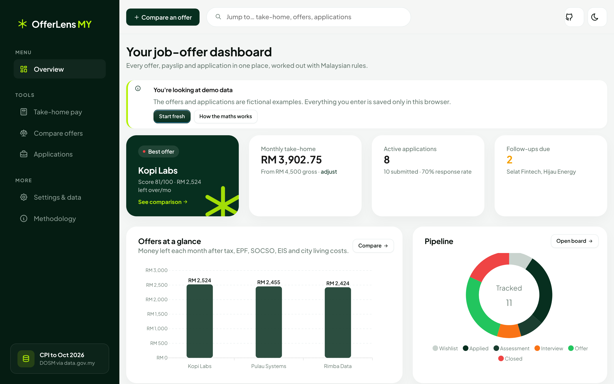
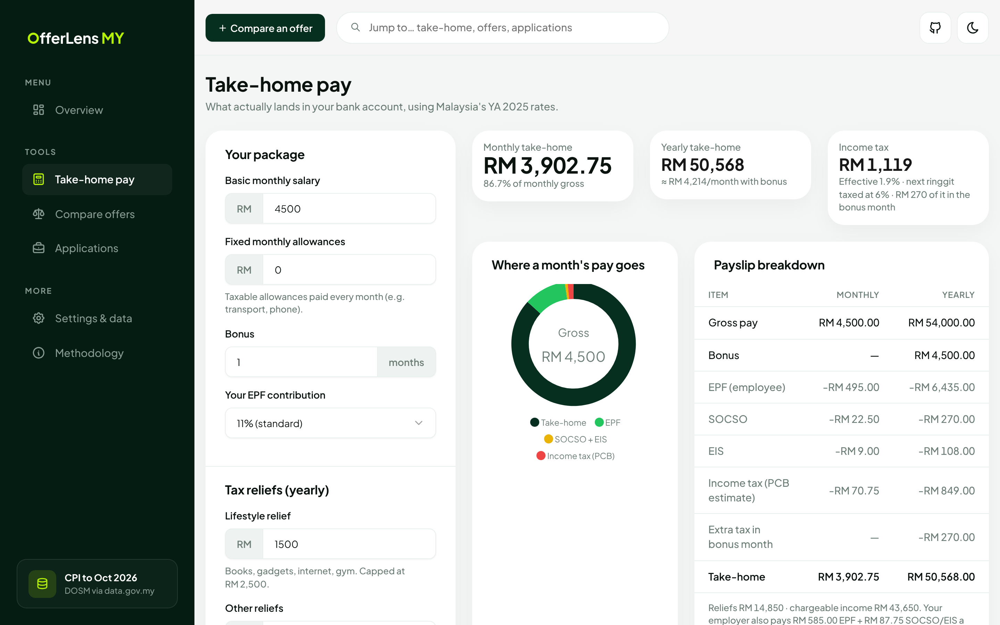
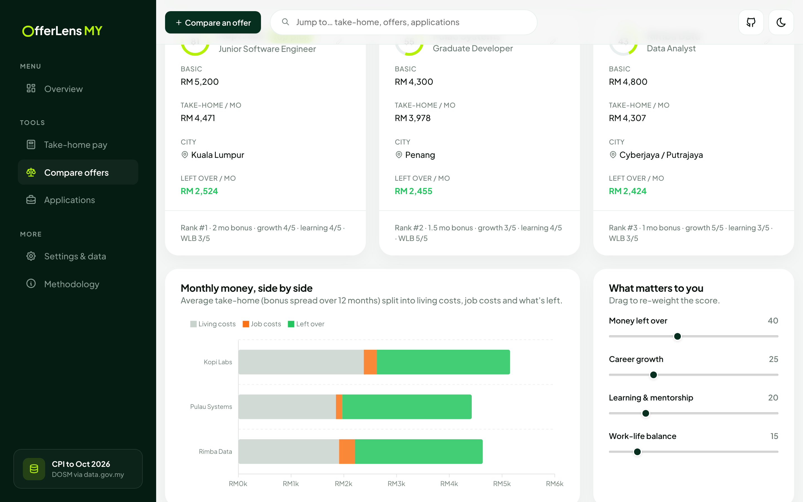
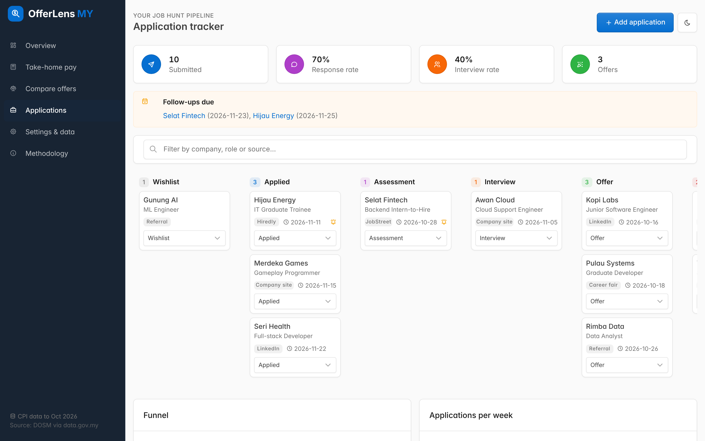
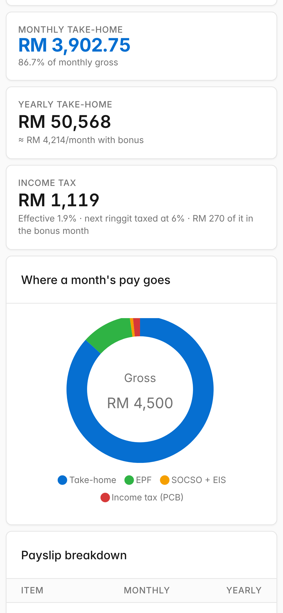

<div align="center">

# OfferLens MY

**Know what a Malaysian job offer is really worth: take-home pay, living costs and a clear answer, all in your browser.**

**[Open the live app →](https://faryaan-khan.github.io/offerlens-my/)**

[](https://github.com/Faryaan-Khan/offerlens-my/actions/workflows/ci.yml)
[](https://github.com/Faryaan-Khan/offerlens-my/actions/workflows/deploy.yml)
[](https://github.com/Faryaan-Khan/offerlens-my/actions/workflows/refresh-data.yml)
[](LICENSE)
<br>
[](https://www.typescriptlang.org/)
[](https://vite.dev/)
[](https://tabler.io/)

<picture>
  <source media="(prefers-color-scheme: dark)" srcset="docs/screenshots/overview-dark.png">
  
</picture>

</div>

---

## Why

Malaysian fresh graduates usually compare job offers on **gross salary**. That number is not what lands in your bank account, and it is not what you have left at the end of the month.

- **Statutory deductions** take a real bite: EPF (11%), SOCSO, EIS and monthly tax (PCB) all come out before you see a sen.
- **Bonus** changes the yearly picture. A 2-month bonus can beat a slightly higher basic, but it also pushes up your tax.
- **Location** matters. RM5,000 in Kuala Lumpur and RM4,500 in Penang are not the same offer once rent, food and commuting are counted.

OfferLens MY works all of that out for you and turns each offer into one comparable number: **money left over each month**. It then lets you weigh that against growth, learning and work-life balance.

## Features

| | |
| --- | --- |
| **Take-home calculator** | Basic salary, fixed allowances, bonus months, EPF rate, lifestyle and other reliefs, zakat. Shows a regular-month payslip breakdown (EPF, SOCSO, EIS, tax), the yearly picture with bonus and the tax on it, where each month's pay goes, employer cost, effective and marginal tax rates. |
| **Take-home curve** | A chart of take-home pay across a range of salaries, with your current salary marked. |
| **Reverse calculator** | Enter the monthly take-home you need and get the basic salary to ask for. |
| **Offer comparison** | Add offers with city, allowances, bonus and job-specific costs (commute, parking, tolls). Rate growth, learning and work-life balance from 1 to 5, set your own weights, and get a ranked score out of 100. |
| **Negotiation helper** | Pick two offers and see the basic salary one would need to match the other's monthly disposable income. |
| **Application tracker** | Kanban board (drag and drop, or a keyboard-friendly stage menu), funnel chart, applications-per-week chart, response and interview rates, and follow-up reminders. |
| **CPI-adjusted living costs** | Editable city baselines at January 2025 price levels (KL, PJ/Subang, Cyberjaya/Putrajaya, Penang, JB, Ipoh, KK, Kuching, remote) scaled by each state's Consumer Price Index from DOSM, refreshed daily. |
| **Private by design** | No backend, no account, no tracking. Everything is stored in your browser's `localStorage`. |
| **Export and import** | JSON backup and restore, plus CSV export of offers and applications. |
| **Dark mode and mobile** | Follows your system theme or a manual toggle, and works on phone-sized screens. |
| **Installable and offline** | Add it to your home screen or desktop from the browser menu. A service worker caches the app so it opens without a connection; CPI data is fetched fresh whenever you are online. |

## Screenshots

| Take-home calculator | Offer comparison |
| --- | --- |
|  |  |
| **Application tracker** | **Mobile** |
|  |  |

## How the numbers work

Every figure comes from small, pure, unit-tested functions in [`src/lib/payroll.ts`](src/lib/payroll.ts) and [`src/lib/offers.ts`](src/lib/offers.ts), using the YA 2025 rates in [`src/data/rates.ts`](src/data/rates.ts).

1. **EPF**: 11% of monthly wages (basic + fixed allowances) and of bonus, rounded up to the next ringgit.
2. **SOCSO / EIS**: 0.5% / 0.2% of wages up to RM6,000, rounded to 5 sen. Not charged on bonus.
3. **Income tax**: yearly gross minus reliefs, run through the progressive bands, less the RM400 rebate (chargeable income up to RM35,000) and any zakat.
4. **Monthly vs yearly**: like a regular-month payslip, the monthly tax and take-home are worked out on salary alone (tax on 12 months of salary ÷ 12). The extra tax caused by the bonus is reported separately and only affects the yearly figures.
5. **Left over** = average monthly take-home (yearly take-home, bonus included, ÷ 12) − city living cost − job-specific costs.

**Worked example:** RM4,500 basic, 1-month bonus, RM1,500 lifestyle relief.

| Item | Amount |
| --- | ---: |
| EPF (11% of 4,500 = 495.00) | RM495.00 / month |
| SOCSO (0.5% of 4,500) | RM22.50 / month |
| EIS (0.2% of 4,500) | RM9.00 / month |
| Reliefs (9,000 individual + 4,000 EPF cap + 350 SOCSO/EIS cap + 1,500 lifestyle) | RM14,850 / year |
| Regular-month tax: chargeable 54,000 − 14,850 = 39,150 → 600 + 4,150 × 6% = RM849 / year ÷ 12 | RM70.75 / month |
| **Monthly take-home** (4,500 − 495 − 22.50 − 9.00 − 70.75) | **RM3,902.75** |
| Yearly chargeable income (58,500 incl. bonus − 14,850) | RM43,650 |
| Yearly tax (600 + 8,650 × 6%), of which RM270 falls on the bonus | **RM1,119** |
| **Yearly take-home** (58,500 − 6,435 EPF − 270 SOCSO − 108 EIS − 1,119 tax) | **RM50,568** (≈ RM4,214 / month) |

The full specification, including rounding rules, the solver and a second example above the SOCSO/EIS ceiling, is in **[docs/METHODOLOGY.md](docs/METHODOLOGY.md)**.

## Always-fresh data

Tax and contribution rates only change with the national Budget, so they live in one reviewed file. Prices change every month, so they are refreshed automatically:

- A scheduled GitHub Action ([`refresh-data.yml`](.github/workflows/refresh-data.yml)) runs every day at 09:17 Malaysia time.
- It calls the free, keyless [data.gov.my](https://data.gov.my/) API for the `cpi_state` and `cpi_headline` datasets from the Department of Statistics Malaysia (DOSM).
- If DOSM has published a new month, it commits the updated [`public/data/market.json`](public/data/market.json) and redeploys the site. Otherwise it does nothing.
- The app scales each city's living-cost baseline by `latest CPI / baseline CPI` for its state, unless you have typed your own figure.

The rest of the project maintains itself too:

| What changes | How often | What happens automatically |
| --- | --- | --- |
| Living costs (state CPI from DOSM) | Monthly | Checked daily; new data is committed and the site redeploys ([`refresh-data.yml`](.github/workflows/refresh-data.yml)) |
| Libraries and build tools | Weekly / monthly | Dependabot opens update PRs; if the full test suite passes they are merged and deployed ([`dependabot-merge.yml`](.github/workflows/dependabot-merge.yml)) |
| Tax bands, reliefs, EPF/SOCSO/EIS rules | Yearly (Budget) | No official API exists, so a monthly check opens a review issue with a checklist when the rates year falls behind ([`yearly-rates-check.yml`](.github/workflows/yearly-rates-check.yml)) |
| Demo data dates, follow-up reminders | Daily | Computed relative to today, so they never go stale |

Details, API calls, safeguards and how to rebaseline: **[docs/DATA.md](docs/DATA.md)**.

## Tech stack

- **[Vite](https://vite.dev/)** and **TypeScript** in strict mode, no framework
- **[Spark Admin](https://themewagon.com/themes/spark/)** design (by ThemeWagon) for the look: forest-green sidebar, lime accents, Plus Jakarta Sans
- **[Tabler](https://tabler.io/) 1.x** (MIT) for the UI components, with Tabler Icons
- **[ApexCharts](https://apexcharts.com/)** for charts
- **[Vitest](https://vitest.dev/)**: about 200 unit tests covering payroll, offers, tracker, storage, market data and the refresh script
- **[Playwright](https://playwright.dev/)** end-to-end tests
- **GitHub Actions** for CI, the daily data refresh and deployment to **GitHub Pages**

## Getting started

Requires **Node.js 22 or later** (see [`.nvmrc`](.nvmrc)).

```bash
git clone https://github.com/Faryaan-Khan/offerlens-my.git
cd offerlens-my
npm ci

npm run dev          # start the dev server
npm test             # run the unit tests (Vitest)
npm run typecheck    # TypeScript, no emit
npm run e2e          # run the end-to-end tests (Playwright)
npm run build        # type-check and build to dist/
npm run preview      # serve the production build locally
npm run data:update  # fetch the latest CPI from data.gov.my into public/data/market.json
```

> **Playwright:** the first time, install a browser with `npx playwright install --with-deps chromium`.

## Project structure

```
offerlens-my/
├── .github/
│   ├── workflows/          # ci.yml, deploy.yml, refresh-data.yml
│   ├── ISSUE_TEMPLATE/     # bug, feature and rate-update forms
│   └── dependabot.yml
├── docs/
│   ├── DATA.md             # data sources and the daily refresh
│   ├── METHODOLOGY.md      # full calculation spec
│   └── screenshots/
├── e2e/                    # Playwright tests
├── public/
│   └── data/market.json    # CPI baseline and latest values (auto-updated)
├── scripts/
│   └── update-data.mjs     # zero-dependency CPI fetcher
├── src/
│   ├── data/               # rates.ts (statutory rates), cities.ts, sample.ts
│   ├── lib/                # pure logic: payroll, offers, tracker, market, storage, format
│   ├── ui/                 # store, charts, DOM helpers and one file per view
│   ├── main.ts             # router, theme, start-up
│   └── styles.css
├── tests/                  # Vitest unit tests
└── index.html
```

## Deployment

The site is a static build (`dist/`) with a relative base path, so it works on GitHub Pages project sites and any static host.

- **GitHub Pages via Actions:** in the repository settings, set **Pages → Build and deployment → Source** to **GitHub Actions**. Pushes to `main` run `deploy.yml`, which runs the unit tests, builds and publishes the site; the daily data refresh triggers a redeploy when new CPI data arrives. If Pages is not enabled, the deploy workflow skips with a notice instead of failing.
- **Private repository note:** GitHub Pages on a private repository requires GitHub Pro, Team or Enterprise. To get the live site on a free account, make the repository public (or upgrade the plan).
- **Any other static host** (Netlify, Vercel, Cloudflare Pages, S3, nginx): run `npm run build` and upload `dist/`. No server code, database or environment variables are needed.
- **Your own copy:** fork the repository, enable Pages as above, and change the site URL in `index.html` (canonical and `og:` tags) to yours. The daily CPI refresh runs in your fork automatically.
- **Releasing:** bump `version` in `package.json`, add a section to `CHANGELOG.md`, tag `vX.Y.Z` and push the tag. When the app shell changes in a way old caches must not serve, bump `VERSION` in `public/sw.js`.

## Roadmap

- [ ] Official PERKESO wage-band tables for SOCSO and EIS instead of the percentage approximation
- [ ] LHDN's PCB (MTD) monthly formula alongside the annual-tax-over-12 estimate
- [ ] KWSP's bonus-month rule for the employer EPF rate (wage + bonus above RM5,000 in that month)
- [ ] More cities and finer-grained living-cost categories
- [ ] Salary benchmarks from DOSM's formal sector wages dataset
- [x] Installable PWA with offline support

## Contributing

Contributions are welcome, especially rate updates after each Budget. Please read **[CONTRIBUTING.md](CONTRIBUTING.md)** and the **[Code of Conduct](CODE_OF_CONDUCT.md)**. Security issues: see **[SECURITY.md](SECURITY.md)**.

## Disclaimer

OfferLens MY gives careful **estimates** for planning and negotiation. It is **not tax, legal or financial advice**. Your payslip may differ by a few sen (SOCSO/EIS brackets) or more (PCB timing, employer-specific rules). For your actual tax position, check with LHDN or a licensed tax agent.

## License and acknowledgements

Released under the [MIT License](LICENSE). Copyright (c) 2026 Faryaan Khan.

- Visual design based on [Spark – Free Bootstrap 5 Admin Dashboard](https://themewagon.com/themes/spark/), distributed by [ThemeWagon](https://themewagon.com/). Credit is kept in the app footer as the template licence asks.
- [Plus Jakarta Sans](https://fontsource.org/fonts/plus-jakarta-sans) via Fontsource, OFL-1.1
- [Tabler](https://github.com/tabler/tabler) and [Tabler Icons](https://github.com/tabler/tabler-icons), MIT
- [ApexCharts](https://github.com/apexcharts/apexcharts.js), MIT
- Consumer Price Index data: Department of Statistics Malaysia (DOSM), via [data.gov.my](https://data.gov.my/) / OpenDOSM, [CC BY 4.0](https://creativecommons.org/licenses/by/4.0/). Living-cost figures in the app are derived from DOSM data, not published by DOSM.
- Statutory rates from public LHDN, KWSP and PERKESO publications.
